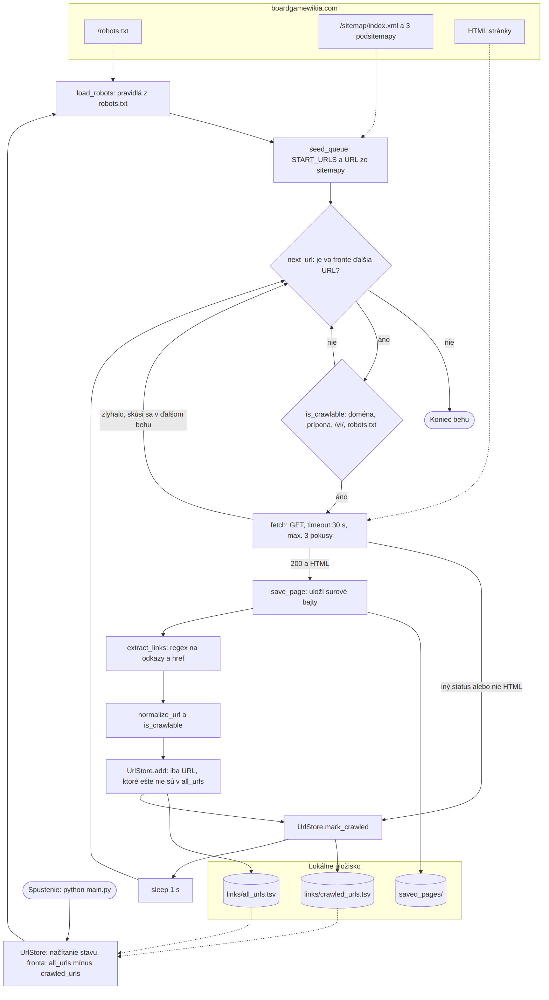

====== Konzultácia 2 ======

Zdroj dát: [boardgamewikia.com](https://boardgamewikia.com) – wiki o stolových hrách (hry, vydavatelia, autori, ilustrátori, mechaniky, kategórie, obchody).

===== Frameworky =====

Crawler je napísaný v čistom Pythone. Používa iba knižnicu `requests`, modul `re` a štandardnú knižnicu, v súlade s pravidlami predmetu.

| Technológia | Na čo sa používa |
| **Python 3.12** | celý projekt |
| **requests 2.34** | sťahovanie stránok (`requests.Session` – jedno TCP spojenie cez keep-alive) |
| **re** | extrakcia odkazov z HTML, čítanie `<loc>` zo sitemap XML, pravidlá z robots.txt (wildcard `*` a `$`) |
| **štandardná knižnica** | `urllib.parse` (skladanie a rozklad URL), `html` (dekódovanie `&amp;`), `hashlib` (skracovanie dlhých názvov súborov), `collections.deque` (fronta URL) |
| **TSV súbory** | ukladanie stavu crawlera (`links/all_urls.tsv`, `links/crawled_urls.tsv`) |

**Zámerne nepoužívame:** BeautifulSoup, lxml ani Scrapy (HTML aj XML parsujeme cez `re`), SQL databázy (stav je v TSV), pandas a NLTK.

**Plánované pre ďalšie fázy:**
- parsovanie uložených stránok – Python + `re`
- indexovanie – PyLucene (docker image)
- distribuované spracovanie – Apache Spark (PySpark)

===== Diagram architektúry crawl systému =====

Fronta sa nikde samostatne neukladá. Pri štarte sa vypočíta ako „všetky známe URL mínus už crawlnuté“. Obidva súbory sa zapisujú hneď po každej stránke, takže crawler na ďalšie spustenie pokračuje tam, kde skončil.

===== Hlavičky / Sleep =====

==== HTTP hlavičky ====

| Hlavička | Hodnota | Odkiaľ |
| `User-Agent` | `VinfProjectBot/1.0 (Contact: xkemenya@stuba.sk)` | nastavené v `HEADERS`; bot sa identifikuje a uvádza kontakt |
| `Accept` | `*/*` | predvolené v requests |
| `Accept-Encoding` | `gzip, deflate` | predvolené v requests (menej prenesených dát) |
| `Connection` | `keep-alive` | predvolené v requests; `Session` používa to isté spojenie pre všetky požiadavky |

==== Timeout, sleep a opakovanie ====

| Nastavenie | Hodnota | Poznámka |
| `REQUEST_TIMEOUT` | 30 s | maximálny čas na jednu požiadavku |
| `CRAWL_DELAY` | 1 s | pauza po každej požiadavke (stránky, robots.txt aj sitemapy); robots.txt nedefinuje `Crawl-delay` |
| `MAX_RETRIES` | 3 pokusy | pri sieťovej chybe alebo HTTP 429, 500, 502, 503, 504; medzi pokusmi čaká 5 s a potom 10 s |
| neúspešná URL | – | nezapíše sa ako crawlnutá, takže ostane vo fronte na ďalšie spustenie |
| 404 a iné chyby | – | zapíšu sa do `crawled_urls.tsv` so statusom a znova sa neskúšajú |

==== robots.txt ====

Crawler si pri štarte stiahne `robots.txt` a pred každou URL kontroluje pravidlá skupiny `User-agent: *`. Vlastný parser podporuje `Allow`, `Disallow` a wildcardy `*` a `$`, pričom vyhráva najdlhšie zhodné pravidlo. Zakázané sú napr. `/login`, `/api/`, `/admin/`, `/change-language/`, `/blog/`, `/shops/*/follow-status`.

Keďže URL ukladáme bez koncového `/`, kontroluje sa aj variant s lomkou. Inak by pravidlo `Disallow: /blog/` nezablokovalo URL `/blog`.

===== Implementácia crawlera =====

{{:user:adam_kemeny:diagram.png?400|}}

==== Postup ====

1. Načíta stav z `links/all_urls.tsv` a `links/crawled_urls.tsv`; fronta = all_urls − crawled_urls.
2. Stiahne `robots.txt`.
3. Načíta sitemap `/sitemap/index.xml`. Je to sitemap index, takže rekurzívne prejde podsitemapy `shops.xml`, `broad_games-1.xml` a `home.xml` (spolu 3 723 URL). Nové URL pridá do fronty.
4. Postupne berie URL z fronty:
   - skontroluje, či sa smie crawlovať,
   - stiahne ju a uloží do `saved_pages/`,
   - vytiahne z nej odkazy a do `all_urls.tsv` aj do fronty pridá len tie, ktoré tam ešte nie sú,
   - zapíše URL do `crawled_urls.tsv`,
   - počká 1 s.

==== Hlavné časti kódu ====

| Funkcia / trieda | Čo robí |
| `normalize_url` | z `href` spraví absolútnu URL: dekóduje `&amp;`, zahodí `#fragment`, zmenší písmená v doméne, odstráni koncové `/` |
| `is_crawlable` | len doména boardgamewikia.com, nie súbory (`.css`, `.js`, obrázky…), nie `/vi/`, povolené v robots.txt |
| `RobotsRules`, `load_robots` | parser robots.txt |
| `fetch` | GET s timeoutom a opakovaním pri dočasných chybách |
| `get_sitemap_urls` | číta sitemap, sitemap index rekurzívne |
| `extract_links` | regex na `<a href>`; najprv odstráni `<script>` a HTML komentáre |
| `UrlStore` | známe URL, crawlnuté URL a fronta; okamžite zapisuje do TSV |
| `save_page`, `url_to_filename` | uloženie stránky do súboru |
| `crawl_page` | spracovanie jednej stránky (presmerovanie, status, uloženie, odkazy) |
| `crawl` | hlavný cyklus, zachytenie Ctrl+C |

Všetky nastavenia (doména, štartovacie URL, hlavičky, delay, timeout, vylúčené cesty, max. počet stránok na jeden beh) sú v sekcii *Configuration* na začiatku súboru.

==== Problémy, na ktoré sme narazili ====

- **Duplicitné URL:** `/ark-nova/` aj `/ark-nova` vracajú 200 bez presmerovania (canonical je s lomkou). Preto sa pri normalizácii odstraňuje koncové `/`.
- **Kódovanie:** robots.txt a sitemapy prichádzajú bez `charset` a requests ich vtedy dekóduje ako ISO-8859-1, čím sa rozbijú vietnamské znaky. Text sa preto dekóduje ako UTF-8 a stránky sa ukladajú ako surové bajty (`response.content`).
- **Falošné odkazy z JavaScriptu:** v `<script>` sú HTML šablóny s `href="${linkHref...}"`. Skripty sa preto pred extrakciou odstránia.
- **Vietnamská kópia webu** (`/vi/...`) duplikuje anglický obsah, preto je vylúčená cez `EXCLUDED_PATH_PATTERNS`.

===== Formát uložených dát =====

links/all_urls.tsv` – všetky známe URL (crawlnuté aj čakajúce):

|url|
|https://boardgamewikia.com/gloomhaven|
|https://boardgamewikia.com/mechanisms/action-queue|
|https://boardgamewikia.com/boardgameartist/alexandr-elichev|
|https://boardgamewikia.com/boardgamepublisher/cephalofair-games|

links/crawled_urls.tsv` – spracované URL, HTTP status, názov súboru a čas:

|url	|status	|file	|crawled_at|
|https://boardgamewikia.com/shops/boardgame-era	|200	|boardgamewikia.com_shops_boardgame-era.html	|2026-10-12 08:28:50|
|https://boardgamewikia.com/gloomhaven	|200	|boardgamewikia.com_gloomhaven.html	|2026-10-12 09:18:52|
|https://boardgamewikia.com/wingspan	|200	|boardgamewikia.com_wingspan.html	|2026-10-12 09:19:32|
|https://boardgamewikia.com/zombicide	|200	|boardgamewikia.com_zombicide.html	|2026-10-12 13:01:45|

`saved_pages/` – jedna stránka = jeden HTML súbor, názov je odvodený z URL (`https://boardgamewikia.com/gloomhaven` → `boardgamewikia.com_gloomhaven.html`).

==== Ukážka stiahnutých stránok ====

==== Stav crawlu (12. 10. 2026, 13:21) ====

| Metrika | Hodnota |
| URL zo sitemapy | 3 723 (z toho 106 vietnamských `/vi/shops/...` vylúčených) |
| známe URL (`all_urls.tsv`) | 7 669 |
| crawlnuté stránky | 1 082 (všetky HTTP 200) |
| veľkosť `saved_pages/` | 293 MB (priemerne ~ 277 KB na stránku, 140 – 964 KB) |

Odkazy zo stránok viac ako zdvojnásobili počet URL oproti sitemape. Sitemap obsahuje hry, obchody a hlavné stránky, ale nie stránky autorov, ilustrátorov, vydavateľov a mechaník.

| Typ stránky (cesta) | Počet známych URL |
|---|---:|
| `/<slug>` – hry a hlavné stránky | 3 554 |
| `/boardgameartist/` – ilustrátori | 1 480 |
| `/boardgamepublisher/` – vydavatelia | 1 413 |
| `/boardgamedesigner/` – autori | 739 |
| `/mechanisms/` – herné mechaniky | 188 |
| `/shops/` – obchody a herne | 116 |
| `/category/` – kategórie | 75 |
| `/boardgame/` | 73 |
| ostatné (`/subdomain/`, `/boardgameexpansion/`, `/collection/`, …) | 31 |
| **Spolu** | **7 669** |

==== Príklady stiahnutých stránok ====

| URL | Súbor | Veľkosť | `<title>` |
| https://boardgamewikia.com/ | `boardgamewikia.com_.html` | 524 KB | Board Game Wikia - Homepage |
| https://boardgamewikia.com/gloomhaven | `boardgamewikia.com_gloomhaven.html` | 308 KB | Gloomhaven (2017) - Boardgamewikia |
| https://boardgamewikia.com/wingspan | `boardgamewikia.com_wingspan.html` | 328 KB | Which Shops Have Wingspan to Play Near My Location? |
| https://boardgamewikia.com/zombicide | `boardgamewikia.com_zombicide.html` | 268 KB | Zombicide (2012) - Board Game Wikia |
| https://boardgamewikia.com/shops/boardgame-era | `boardgamewikia.com_shops_boardgame-era.html` | 424 KB | Everything about Boardgame Era Coffee Shop - Board Game Wikia |
